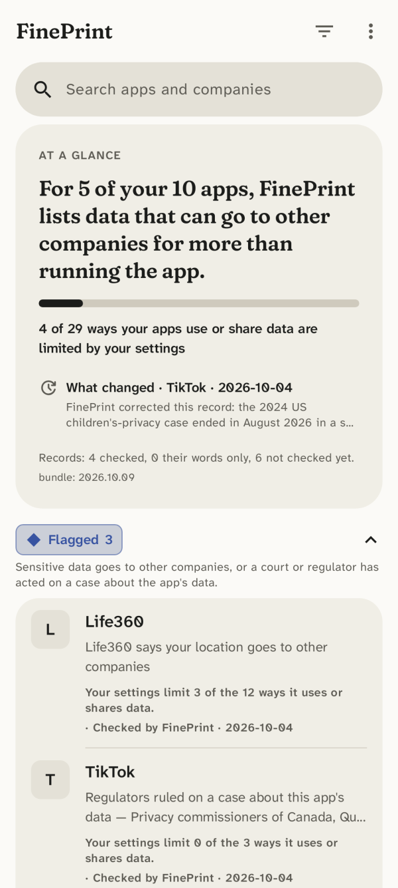
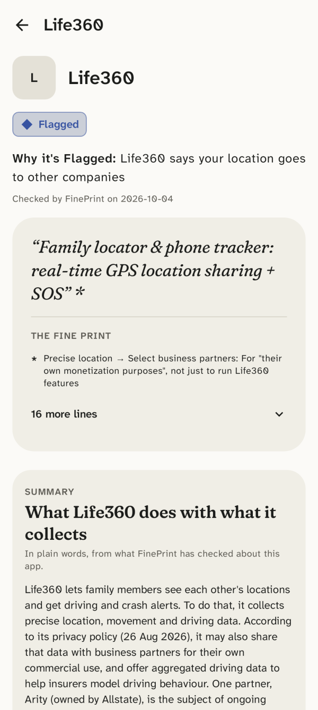

# FinePrint

**Status: pre-release.** There is no released build; test builds go out by invitation. The
[preview build](#preview-build) is a CI artifact for browsing the design — it scans nothing.

FinePrint shows, for each app on your phone, what data it collects, who gets it, and whether it's used
beyond running the app. Android shows which permissions an app has. FinePrint shows where the data can go.

- **Sourced and quoted.** Each claim cites a dated source and quotes the words that support it. A person
  checks it against that source before it reaches the app. A claim FinePrint infers from tracker code
  alone carries the badge Auto: no person has checked it.
- **The companies' own words come first.** Where FinePrint has it, an app's page opens with Their words:
  the app's own short description on Google Play, word for word. Its privacy policy is quoted, not
  paraphrased.
- **A tier describes the data, not the app.** Flagged, Caution and Expected follow
  [published rules](docs/METHOD.md#tiers), the same for every app.
- **No advice to uninstall.** FinePrint shows the settings that limit where data goes. It never suggests
  uninstalling anything.
- **Open data.** Every claim FinePrint has checked, with its sources, is under CC BY 4.0.

Take Life360. Android shows that it can use your location. FinePrint's page for it reads: *Why it's
Flagged: Life360 says your location goes to other companies.* According to Life360's privacy policy
dated 2026-08-26, "select business partners" can use your precise location for "their own monetization
purposes".

The Texas Attorney General sued Allstate and its subsidiary Arity on 2025-01-13. The Attorney General
alleged that they collected driving data through "secretly embedded software in mobile apps, such as
Life360" (not proven in court). Life360 is not a defendant. Part of the case was dismissed on
jurisdiction grounds and is under appeal.

Under What you can do, FinePrint names the settings that limit that sharing. One is Trusted Partners, in
the Privacy section of Life360's account settings. FinePrint can't change it. You tick it once you've
changed it yourself.

No accounts, no analytics, no crash reporting, no ads and no trackers. FinePrint checks your apps on your
phone, and nothing about them leaves it. It downloads its knowledge bundle whole, so no server learns
which apps you have. Android first; iOS later, by importing the iPhone's App Privacy Report. Free and
open source.

## Screenshots

<p>
  
  
</p>

Drawn by the screenshot tests (`./gradlew readmeScreenshots`), never by hand, from knowledge bundle 2026.10.09
(with tracker batches 1 and 2 and their follow-ups) and the scan fixture: the test emulator's apps, plus Google Maps, which has a
record but isn't installed there.
In dark mode: [the home](docs/screenshots/home-dark.png) and [Life360](docs/screenshots/detail-dark.png).

## Preview build

A debug build for browsing FinePrint on any phone as it evolves, installed beside the real app. It shows the
sample apps in the scan fixture with the knowledge bundle built in. It scans nothing on the phone and makes no
network calls: its manifest has no internet or package-query permission, and Open app info is turned off.

- Build it: `cd android && ./gradlew assemblePreviewDebug`; the APK is
  `android/app/build/outputs/apk/preview/debug/app-preview-debug.apk`.
- Or download it: every CI run keeps it for 30 days as the `fineprint-preview` artifact, a zip on the run's page
  under Actions (signed-in GitHub users only). It's never attached to a release.
- Sideload it: copy the APK to the phone and open it, letting your browser or file manager install unknown apps
  when asked (or `adb install` it). It installs as FinePrint preview (`com.longlifeio.fineprint.preview`), with
  its own Reviewed marks.
- It's debug-signed, so Play Protect warns that it comes from an unknown developer.
- Its home has a theme switch under the Preview line: System follows the phone, and Light or Dark sets every
  screen. The choice isn't saved, so the preview opens at System again once Android has closed it.

## Layout

- `bundle/` — the knowledge base: `schema.json` (the contract), `bundle.json` (checked, sourced records) and `jurisdictions.json` (each country's laws for compelled access). CC BY 4.0.
- `pipeline/` — Python scripts that fetch sources, draft records with an LLM, queue them for a person to check, and build the bundle. Runs on a Mac Mini.
- `android/` — Kotlin / Jetpack Compose app. The scanning module is called `egress`. Two flavours: `device`, the
  app itself, and `preview` (above), whose code lives only in `src/preview`.
- `docs/` — `METHOD.md` (How to read this, which the app ships word for word), `privacy.md` (FinePrint's own
  privacy page) and `TESTING.md` (for invited testers).
- `prompts/` — Claude Code prompts for each build slice.

## Before committing

```sh
brew install pre-commit && pre-commit install   # pre-commit and pre-push hooks
pre-commit run --all-files
```

The hooks run `gitleaks`, block keystores, `local.properties`, `.env` and anything in
`pipeline/raw/` or `pipeline/drafts/`, and fail on macOS home-directory paths, Tailscale addresses
and host names, and mDNS host names (patterns in `tools/check_private.py`). Private strings such as your own
email go one per line in `.git/private-patterns`: that file is never committed, so the strings it
guards stay out of the repo too.

Owner's manual steps on GitHub: turn on secret scanning push protection (Settings → Code security),
and commit with the GitHub noreply address (`git config user.email <id>+<user>@users.noreply.github.com`).

## Status

G1 to G3 are signed off on an Android 17 emulator, G5 is built, and the schema is at v1.7:

- G1, the scanner: installed apps, their permissions and the tracker SDKs in their code (Arity in
  Life360).
- G2, the knowledge bundle: downloaded whole, and a data-first explanation per app, every claim
  sourced. Checked records for Life360, Facebook, TikTok and Google Maps, with company records for
  the companies behind them.
- G3, the UI pass: tiers by a published formula (`docs/METHOD.md`), the same sections with their
  definitions on every page, a Sources sheet, How to read this, Reviewed marks and the "What you
  can do" checklist, with tap targets of 48dp or more enforced by a test.
- G5, the design pass: the Field notes design system on the home, the detail screen and a three-page
  introduction, with colour only on tier and bucket chips and its contrast and colour-blind
  separation enforced by a test. The detail screen opens with "Their words", the app's Play listing
  short description quoted verbatim, then the fine print. Screenshot tests draw the home, Life360,
  its Sources sheet, Facebook's and Life360's pages whole, How to read this and the introduction,
  light and dark, at 150% and 200% text and on a small phone and a tablet (and the README's images);
  every device test runs the accessibility checks, and TalkBack was checked on the emulator.
- Schema v1.3: one tracker record covers several Exodus ids (`covers[]`); a record's history, with
  the direction of each change (`changes[]`); ongoing and past legal actions, where only ongoing
  or recent ones set a tier; government access, with a checked table of laws per country
  (`bundle/jurisdictions.json`) and where each company is based; a policy's region; flows that are
  off by default or opt-in; and apps that came with the phone showing their maker's policy lines.
- Schema v1.4 and v1.5: `store_tagline` on app records (Life360, Facebook and TikTok, quote-checked
  against the saved listing); every flow has an id; and a record's changes, like Reviewed marks,
  count rulings, lawsuits and a flow's evidence, never wording.
- Schema v1.6 and v1.7: when FinePrint checked an app (Checked by FinePrint, or Their words only);
  whether a claim is before a court or a regulator, and a regulator's formal proceeding; flows that
  hang on something FinePrint can't see, a setting or an agreement (shown, never scored); a
  tracker's sourced purpose; and a short line for each law, shown first, with the law's full text
  opening under it.
- The reading pass: plain words throughout, with a Voice section in `docs/METHOD.md` and a
  readability report on every build (CI warns, never fails); under each app's name, the reason for
  its tier ("Why it's Flagged: Life360 says your location goes to other companies"), with what set
  it listed first under "Why it's Flagged"; a search bar on the home; and an edge on every card in
  dark mode.
- After a test on a phone (main at 4be58f0):
  - An app's page opens with its header, Their words, its Summary and What you can do. The header has
    no progress line; the package and version sit at the page's foot, under the bundle line. Every
    section after that starts as a row with a one-line summary in small type that opens in place
    ("Where it goes · 2 ways, 0 limited by your settings"). Jurisdictions is a section of its own
    ("Based in: United States").
  - Their words starts closed: the quote, the fine print's first claim without its source, and a row
    saying how many more. The row opens the card in place, and it stays open for the visit. A claim
    from a lawsuit keeps "not proven in court" while the card is closed.
  - What you can do shows what FinePrint reads from Android in a dashed box, the setting before and
    after ("Use precise location: On → Off"), and what you tick in a solid one, with the day. A key
    says which is which. Open app info sits in the card, and FinePrint reads the permissions again
    when you come back.
  - The Why line is the tier's label and the reason, nothing more. For a decided case it says who
    acted and what came of it: ruled on, settled, or a court approved a settlement. Facebook's reads
    "Why it's Flagged: a regulator ruled on a case about this app's data — Data Protection Commission
    (Ireland), 2024".
  - At a glance no longer counts apps per place, and a row in a tier's section leaves the tier to its
    header. A source's Open button goes to the quoted words where the browser supports it.
- Tracker records for 24 common SDKs (covering 29 tracker ids) and 26 company records, with tracker
  batches 1 and 2 merged: bundle 2026.10.09 holds them with the 4 app records and 10 jurisdictions.
  A tracker's legal and reported lines show under On the record on every app that carries it, marked
  about its company, and count toward a tier only when they name the app; practices reported in the
  past go under Past. A company's changes of ownership show as a dated chain on its Sources sheet
  (Affle's purchase of AdColony first). When a record says what its sources leave uncertain
  (AdColony's, IAB Open Measurement's, InMobi's, OneSignal's and Vungle's do), every Sources sheet
  for its lines ends with that note, under About these sources; its confidence level is never shown.
  FinePrint's own signatures sit beside εxodus's: Arity's, and Vungle's SDK 7.
- The laws table, checked entry by entry: fourteen laws in force in ten places (the US, Canada,
  China, the EU, Israel, Russia, Norway, Germany, Singapore and India), each with who it binds,
  whether the company may tell you it handed data over, when FinePrint last checked it and a Stale
  marker; an EU regulation is keyed to the member states it binds. Laws that bind only licensed
  telecoms, or that permit disclosure rather than compel it, are parked as drafts.
- The watcher (`pipeline/watch.py`): it re-reads every quoted page weekly and two regulators' feeds
  daily, and queues what changed for a person to check; it never edits a record. Pages only a
  person can capture (their text needs JavaScript) are marked `manual`: no script fetches them,
  their copies are saved by hand and quote-checked like any other, and every digest lists them for
  checking before each release (`pipeline/README.md`).
- The tester pages. About gives the app's version and the bundle's, with its date, and says in plain words what
  FinePrint is and isn't. It states the funding rule, links to the source code, both GitHub forms and the privacy
  page, and lists the licence of everything in the APK. dexlib2's is BSD 3-Clause, and its text ships with the
  others. `docs/privacy.md` is FinePrint's own privacy page, and `docs/TESTING.md` is for invited testers, once the
  signed release is out (Next 3). The bundle download names FinePrint and its version, nothing about the phone, and
  the manifest drops AndroidX's request to Google Play services for an emoji font.
- Guided paths (G6, slice 1) and schema 1.8. An item you tick can carry the steps to reach it, from the company's own
  help page. Show me how opens them in place, one card at a time: a screen's name over grey rows, with the one to tap
  highlighted and labelled, never a copy of the other app's screen and no logo. The last card opens the app, or the
  web page with the setting, and says where the steps come from: a walk in the app, with its version and date, or the
  help page and its date. A walk is marked Stale after 90 days; a path nobody has walked never is, since the help
  page's date is the company's and the watcher re-reads the page. Under the last card is the item's own tick; under
  the cards, the help page's quotes. Life360's three settings have paths from its help page of 11 May 2026, which also
  says Your Privacy Choices covers its traffic and retail insights; nobody has walked them in the app yet, so they say
  they come from the help page. Life360's record dates the change (neutral), so its Summary's latest change says so.
  Schema 1.8 also adds a short name for a legal event's body, which the Why line uses while On the record keeps the full
  name (TikTok's: four Canadian privacy commissioners), and `changes[]` on company and tracker records; a 1.7 bundle
  still validates.

The phone test is done (main at 4be58f0, above). The Tailscale path, for a debug build on a phone, is still deferred
by choice. See `CLAUDE.md` for the gates.

Next, in order:

1. Follow-ups to the tracker batches: Mintegral's and InMobi's privacy policies, saved by hand
   (`manual`). With the first `manual` source, `build.py` passes the flag through to the bundle (an
   added field), so a source's Open button takes a page saved by hand to its top, not to the quoted
   words; today it drops the flag.
2. G6: a walk of Life360's three paths in the app (`verified_on`); the rest of the first batch; and Guide mode.
3. Signed release — after guided paths (G6). The release carries the bundle's three files, which the release
   build downloads from `releases/latest/download/`. Its address and a private channel for testers replace the
   placeholders in `docs/privacy.md` and `docs/TESTING.md`. Terms, and a legal review of About's note on sources and
   legal advice, are still to come.
4. AGP 9.5.0, once it's stable: move to it and take out the lint line in `android/gradle.properties`. Until then the
   release build runs lint from AGP 9.5.0-rc01, because 9.4.1's crashes on `build.gradle.kts`.

Logged for G6 (not built yet):
- Guided paths, still to come (slice 1 built the schema and the cards): fallback steps for screens
  that have changed ("If you don't see Privacy, tap Search in Settings and type 'privacy choices'"),
  and the rest of the first batch, the ten most useful controls across Google's ad settings, Meta's ad
  preferences and off-Facebook activity, and TikTok's personalization (Life360's three are in). Help-page
  changes reach a path through the watcher, which re-reads its quotes as it does every source's.
- Guide mode. The same steps as a small, movable floating card (Next / Back / Done) over the real
  app while the user moves through it themselves. Draw-only: it needs only the overlay permission,
  reads nothing, captures nothing, has no input fields, and is opt-in per walkthrough, never
  persistent. Permission prompt: "This lets FinePrint show step cards over other apps. It cannot
  see what's on your screen." The deep link makes the first jump; the user moves on by tapping
  Next; Done, or going back to FinePrint, closes the card and offers to tick the control with
  today's date. How to read this explains why FinePrint's use of an overlay differs from the
  device-access warning about overlays. For Play: declare the overlay permission's purpose. Never
  in scope: a sandbox copy of another app with a test account, or any Accessibility-based
  highlighting.

Queued: laws to check (not started):
- Ireland's domestic powers over companies based there: its e-Evidence implementing act and the
  warrant or production powers Gardaí use.
- Norway: Criminal Procedure Act § 210 b (orders for evidence that will come into someone's
  possession) and § 215 a (data preservation orders).
- Germany: StPO § 100j (subscriber data) and TDDDG §§ 22–24.
- Singapore: Criminal Procedure Code ss. 39–40 (access to computers and decryption information).
- India: Digital Personal Data Protection Act s. 36.
- US national law beyond the CLOUD Act and FISA: the Stored Communications Act, 18 U.S.C. § 2703
  (the everyday warrant, order and subpoena route for app data); national security letters,
  § 2709; FISA Title I, 50 U.S.C. § 1805(c)(2)(B).

Logged for later:
- Open, for the owner to decide: a fourth government line type for voluntary hand-over on
  request, applied evenly to every country (US 18 U.S.C. § 2702; GDPR arts. 6 and 48; Canada's
  PIPEDA s. 7(3)(c.1); the rest), or whether that belongs at the company-policy layer instead.
- Open, for the owner to decide: court findings about a law as a line of their own under
  Jurisdictions, applied evenly to every law or not at all. Podchasov v. Russia (ECtHR, 2024: the
  decryption duty breached art. 8; Russia left the Convention in 2022 and the ruling doesn't change
  its law) for art. 10.1; Schrems II (CJEU, 2020) for FISA 702; whatever exists for the others.
- A "What matters to me" setting that lets the user choose which jurisdictions and ways of getting
  data to highlight (from the government-access plan; the rest shipped in v1.3).
- v2: data exports the user supplies (Facebook's "Download your information", Google Takeout),
  read on the phone to check the in-app settings they report, the same pattern as the iOS App
  Privacy Report import.
- The watcher's slice 2 (archived copies for parked hosts, more regulator and court sources,
  app-version signals): `pipeline/README.md`, "Watcher: slice 2".
- Sources sheet: an archived-copy link beside each source, so a cited page that goes dead for users
  still opens.

## Licence

Code: AGPL-3.0-or-later. Data in `bundle/`: CC BY 4.0 (`bundle.json` and `jurisdictions.json`). Tracker
signatures (`bundle/trackers.json`, copied into the app as `android/app/src/main/assets/trackers.json`) are
derived from the [εxodus](https://exodus-privacy.eu.org/) tracker database and are under the Open Database
License (ODbL) 1.0. FinePrint is not affiliated with or endorsed by Exodus Privacy.
